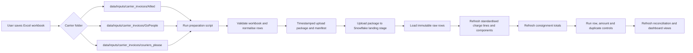

# Invoice Ingestion Process and Snowflake Table Design

This process is for Allied Express, GoPeople and Couriers Please invoice workbooks. It preserves the original Excel evidence, creates reconciliation-ready CSV files, and loads the information into Snowflake without overwriting earlier invoice versions.

## Operating flow



## User process

### 1. Save the invoice workbook

Save the workbook without renaming its worksheets into the appropriate folder:

| Carrier | Folder |
|---|---|
| Allied Express | `data/inputs/carrier_invoices/Allied/` |
| GoPeople | `data/inputs/carrier_invoices/GoPeople/` |
| Couriers Please | `data/inputs/carrier_invoices/couriers_please/` |

Do not delete previously loaded workbooks. A revised workbook should be retained so its filename, hash and load can be audited. The current loaders read all workbooks in the selected carrier folder and apply their existing carrier-specific de-duplication rules.

### 2. Generate the upload package

From the project root, run one command for the carrier received:

```powershell
& ".\scripts\prepare_invoice_snowflake_upload.ps1" -Carrier allied
& ".\scripts\prepare_invoice_snowflake_upload.ps1" -Carrier gopeople
& ".\scripts\prepare_invoice_snowflake_upload.ps1" -Carrier couriers_please
```

The optional `-InputFile` parameter confirms that a particular workbook is present in the expected folder:

```powershell
& ".\scripts\prepare_invoice_snowflake_upload.ps1" `
    -Carrier couriers_please `
    -InputFile ".\data\inputs\carrier_invoices\couriers_please\invoice.xlsx"
```

The script creates a package under:

```text
outputs/snowflake_upload/<carrier>_<UTC load id>/
```

The package contains the carrier-specific normalised CSV files and `upload_manifest.json`. The manifest records the load ID, input workbook names, file hashes, sizes, timestamps and generated outputs.

### 3. Review the local controls before uploading

Check the generated control summary before loading Snowflake:

| Carrier | Main output | Control output |
|---|---|---|
| Allied Express | `allied_charge_lines.csv`, `allied_jobs.csv` | `allied_invoice_control_summary.csv` |
| GoPeople | `gopeople_charge_lines.csv`, `gopeople_consignments.csv` | `gopeople_invoice_control_summary.csv` |
| Couriers Please | `couriers_please_charge_lines.csv` | `couriers_please_invoice_control_summary.csv` |

The control summary should be checked for source row count, distinct billed consignment/job count and total ex-GST cost. Stop the process if the workbook is empty, a required header is not detected, or the total differs from the Finance source control.

### 4. Upload to Snowflake

Upload the generated package to the approved Snowflake landing stage, for example:

```text
@LAST_MILE_RAW.INVOICE_STAGE/<carrier>/<load_id>/
```

The exact database, schema, stage and role should be configured by the Snowflake owner. Uploading through Snowsight is acceptable for the first version. A later automated version can use SnowSQL or a CI job.

The upload must include:

- the generated CSV files
- `upload_manifest.json`
- the `load_id` used for the package

The load must be registered in `LAST_MILE_RAW.INVOICE_LOAD` before applying the curated tables.

### 5. Refresh the Snowflake tables

The refresh should run in this order:

1. Insert the load metadata into `INVOICE_LOAD`.
2. Load the original or normalised source rows into `INVOICE_SOURCE_ROW`.
3. Merge accepted rows into `INVOICE_CHARGE_LINE`.
4. Rebuild `INVOICE_CHARGE_COMPONENT` from the charge-line amounts and source charge codes.
5. Aggregate `INVOICE_CONSIGNMENT` at carrier-consignment grain.
6. Run the reconciliation process to populate `INVOICE_RECONCILIATION`.
7. Refresh the dashboard views or semantic layer.

The table refresh should be implemented as one Snowflake stored procedure or task, for example:

```sql
CALL LAST_MILE_CORE.SP_APPLY_INVOICE_LOAD(
    '<carrier_code>',
    '<load_id>',
    '@LAST_MILE_RAW.INVOICE_STAGE/<carrier>/<load_id>/'
);
```

The procedure should fail the load if the controls do not pass. It should not partially publish a carrier load.

### 6. Run the post-load controls

At minimum, validate:

- source rows loaded equal the upload manifest and control summary
- distinct CP consignments, Allied jobs and GoPeople consignments are within expected totals
- component totals reconcile to the invoice total
- GST is held separately from ex-GST amounts
- invoice numbers, tracking numbers, dockets and postcodes remain text values
- duplicate and revised workbook rows are flagged rather than silently deleted
- records with no tracking or Kmart reference are retained and reported as unmatched
- the latest load is visible in the invoice availability view

## Carrier-specific normalisation

| Carrier | Source grain | Consignment grain | Important source fields |
|---|---|---|---|
| Couriers Please | One billed consignment row | `carrier_invoice_number + carrier_consignment_reference` | Consignment Ref., Customer Other Reference 1, service code, origin/destination, items, weight, volume, chargeable weight, declared/measured values, base, fuel, insurance, other fee, remote-area surcharge, GST |
| Allied Express | One charge row | `docket + job_number` | Docket, job number, reference, external order ID, week number, charge code/type, charged and declared weight, declared volume, items, charge date, transaction date, base, fuel, excess-weight, delivery and other components |
| GoPeople | One carton/charge row | `source_file + source_sheet + carrier_invoice_number + tracking_number` | Consignment Number, invoice number, carton number, charged weight, cubic weight, declared weight, cubic volume, distance, price GST exclusive, GST and invoice notes/comments/fuel |

For GoPeople, fuel parsed from the invoice notes field is retained as a derived component and the original notes value remains available for audit. For Allied, multiple charge rows are aggregated to the job while retaining every original charge row. For CP, repeated rows are retained in raw storage and the curated layer applies the documented precedence rules.

## Snowflake table design

### `LAST_MILE_RAW.INVOICE_LOAD`

One row per imported workbook and worksheet. It records the file hash, load ID, source period, row counts, status and timestamps.

### `LAST_MILE_RAW.INVOICE_SOURCE_ROW`

One row per original Excel row, with the original row held in `RAW_ROW VARIANT`. This is the immutable audit layer.

### `LAST_MILE_CORE.INVOICE_CHARGE_LINE`

The common row-level invoice table. It contains invoice identifiers, tracking/reference fields, dates, service, origin/destination, physical measures, source charge codes, standardised component code and ex-GST/GST amounts.

Use `VARCHAR` for identifiers, `DATE` for service and invoice dates, `NUMBER(18,4)` for currency, `NUMBER(18,6)` for weights and `NUMBER(18,9)` for cube. Missing source values should remain `NULL`, not zero.

### `LAST_MILE_CORE.INVOICE_CHARGE_COMPONENT`

A long-form monetary table with one row per component such as `BASE`, `FUEL`, `INSURANCE`, `REMOTE_AREA`, `EXCESS_WEIGHT`, `DELIVERY`, `OVERSIZE`, `OTHER` or `UNALLOCATED`. It stores the original code, allocation method and whether the component was derived.

### `LAST_MILE_CORE.INVOICE_CONSIGNMENT`

One row per billed carrier consignment or job. It stores the aggregated physical measures, source row count, component totals, total invoice cost, GST and control differences.

### `LAST_MILE_MART.INVOICE_RECONCILIATION`

One row per Stage 3 consignment-to-invoice relationship. It stores the match method, modelled cost, invoiced cost, variance, physical gaps, primary driver and root cause. This is derived from the invoice tables and Stage 3 data; it is not the raw invoice source.

## Current repository versus target Snowflake process

The preparation script uses the existing local Excel loaders and creates an upload package. The current Streamlit application still reads its local reconciliation outputs, so uploading to Snowflake alone will not change the current app until its invoice views are switched to the Snowflake curated tables.

Until that connection is implemented, the local operational refresh remains:

```powershell
& ".\.venv\Scripts\python.exe" -m src.carrier_invoice_<carrier>_reconciliation
& ".\.venv\Scripts\python.exe" -m src.reconciliation_store --mode refresh-invoices --dataset-name live --incremental-carrier <carrier>
```

The Snowflake design should become the system of record first, with the application then reading the curated consignment and reconciliation views rather than generated CSV files.
